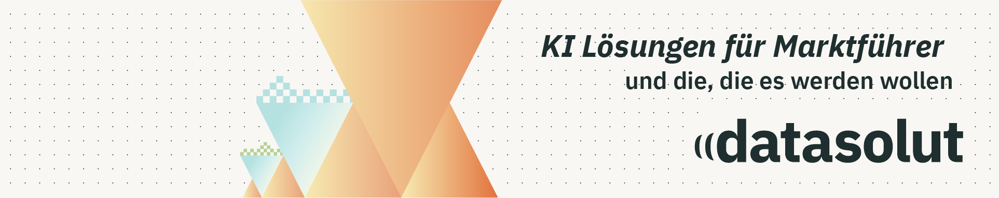

<a href="https://datasolut.com">
  <picture>
    <source media="(prefers-color-scheme: dark)" srcset="https://raw.githubusercontent.com/datasolut/.github/main/profile/assets/banner-dark.png">
    
  </picture>
</a>

### Daten + KI Lösungen für Marktführer – und die, die es werden wollen

Wir bauen moderne Datenplattformen auf Databricks und bringen KI produktiv in Ihr Unternehmen: von der Architektur über Data Engineering bis zum laufenden Use Case. Als Databricks-Partner aus Köln beraten, entwickeln und schulen wir.

Hier auf GitHub teilen wir den Code zu unseren Tutorials – zum Nachbauen und Weiterlernen.

  
  
  
  
  

